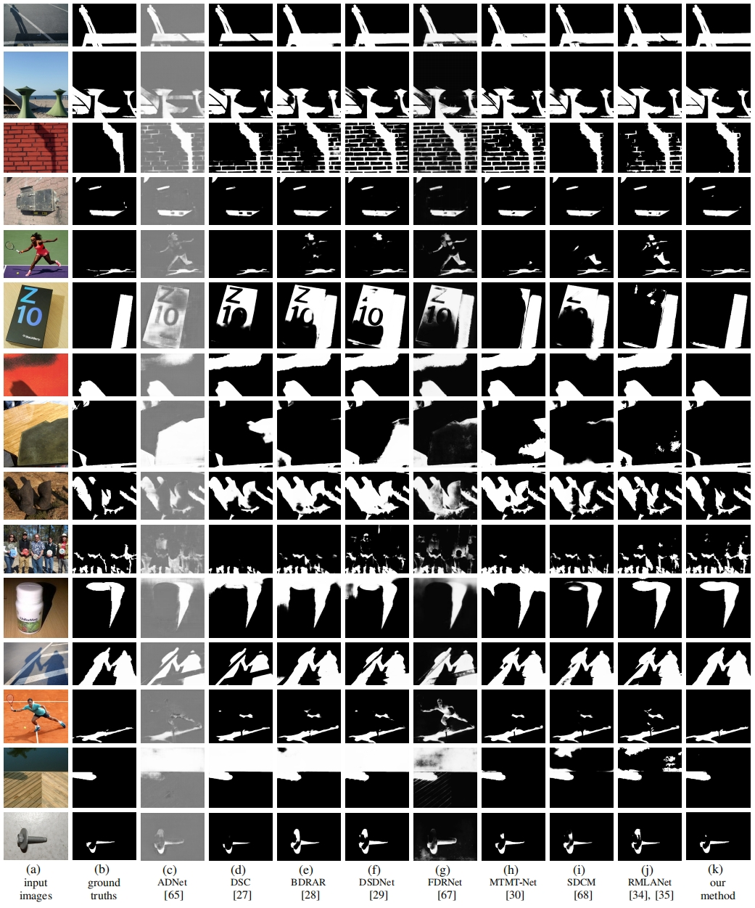

# AdapterShadow
Source code for our paper ["AdapterShadow: Adapting Segment Anything Model for Shadow Detection"](https://arxiv.org/abs/2311.08891). A new version of our paper was accepted by Expert Systems with Applications (https://www.sciencedirect.com/science/article/pii/S0957417425004312).

# How to evaluate ?
```
python pl_test_simple.py -net sam -exp_name sbu -npts 5 -backbone b1 -plug_image_adapter -all -freeze_backbone -use_neg_point -sample grid -grid_out_size 16
```
Before running, please specify the corresonding dataset name by:
-dataset_name sbu (or -dataset_name cuhk)

How to obtain the datasets:
(1) for SBU, UCF, CUHK and ISTD, please refer to:
https://github.com/LeipingJie/SAMShadow

(2) for SBU_New, please refer to:
https://github.com/hanyangclarence/SILT

You can find our code, results at:
[Code & Results](https://drive.google.com/drive/folders/1vpETQm5TMFkC7frHi8y83q5hxxq4vY3M?usp=sharing)
Pretrained modes at: 
link: https://pan.baidu.com/s/11F5J1Qk8KDZKrAJ91409ng?pwd=27v2
password: 27v2

## Visual Comparison


If you find this project useful for your research, please cite:
```
@article{jie2025shadowadapter,
  title={ShadowAdapter: Adapting Segment Anything Model with Auto-Prompt for shadow detection},
  author={Jie, Leiping and Zhang, Hui},
  journal={Expert Systems with Applications},
  pages={126809},
  year={2025},
  publisher={Elsevier}
}
```
